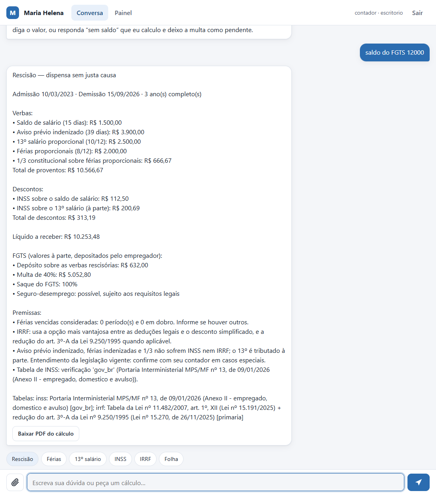
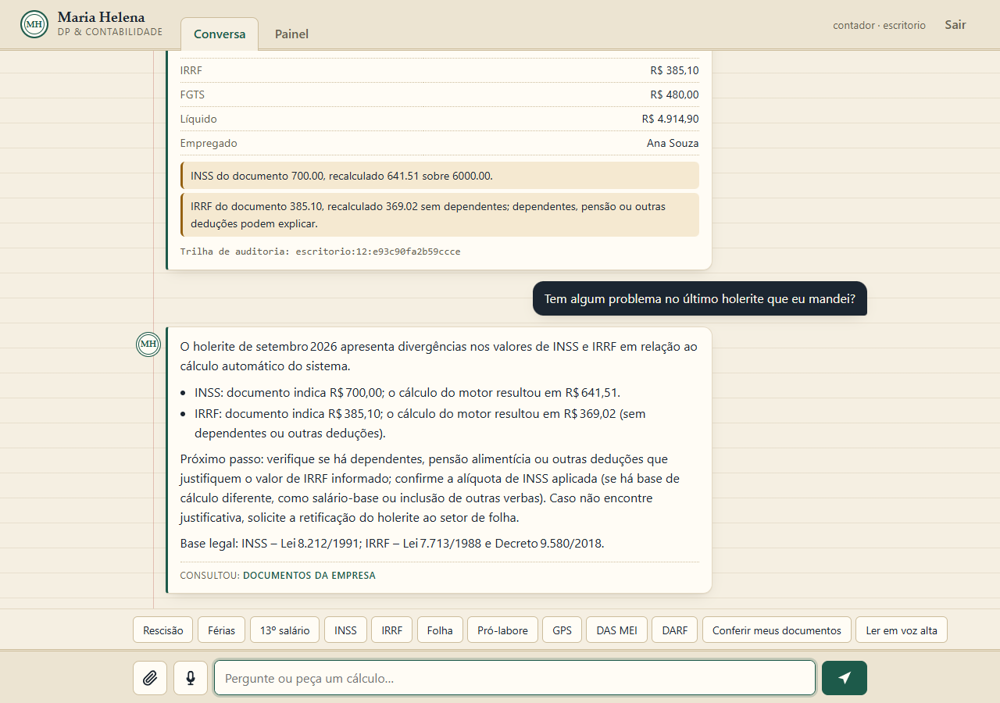
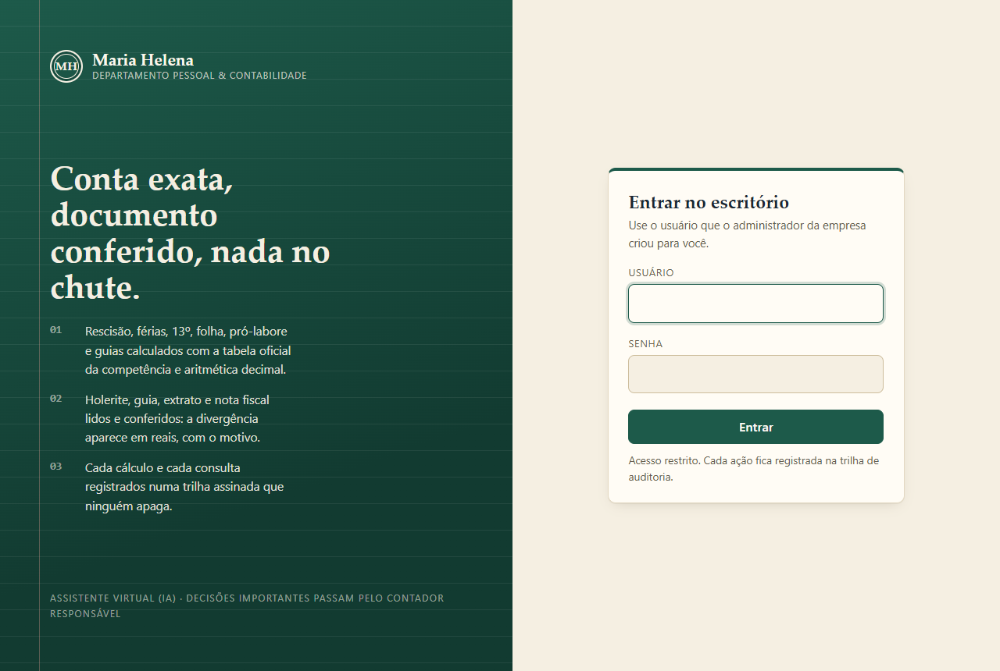
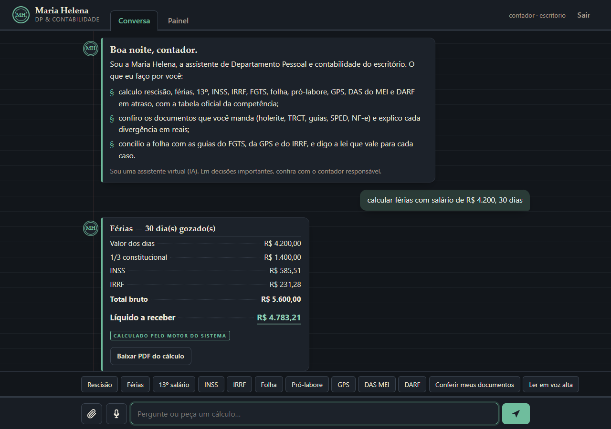
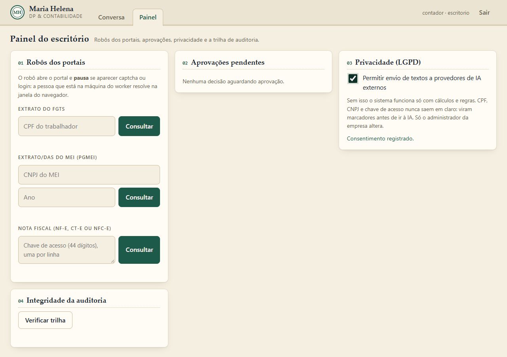
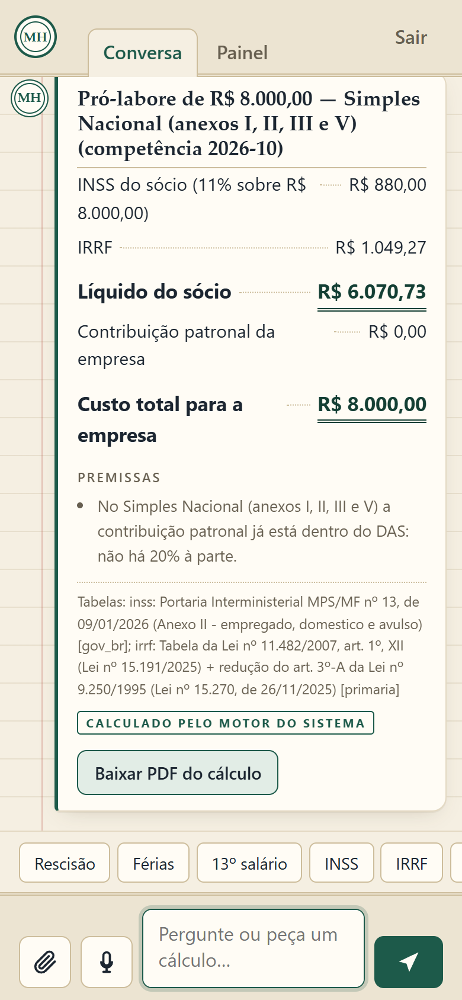
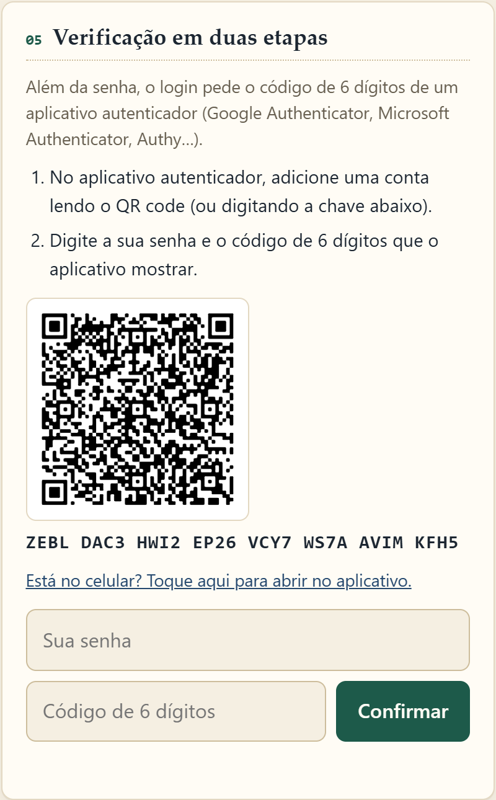
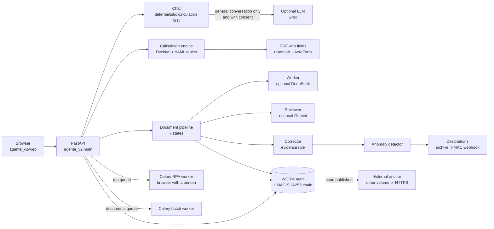

# Sovereign Accounting Agent

[](https://www.python.org/)
[](https://fastapi.tiangolo.com/)
[](LICENSE)
[](https://github.com/matheusStark25/sovereign-accounting-agent/actions/workflows/ci.yml)

**English** · [Português](README.pt-BR.md)

A **payroll and accounting assistant** for Brazilian law. It computes termination pay, vacation pay, the 13th salary,
social security (INSS), withholding income tax (IRRF), the severance fund (FGTS) and full payroll with exact decimal
arithmetic, and it generates the calculation PDF. It reads and checks 27 document types (payslips, termination
statements, tax slips, SPED files, XMLs). It fetches FGTS and MEI statements and electronic invoice summaries (NF-e, CT-e,
NFC-e) with bots that **pause for a person** to solve the login or CAPTCHA, and it downloads the full NF-e XML from the
official tax authority web service using the company's digital certificate. Everything runs behind authentication with
two-factor login, per-company isolation, prompt-injection defenses and a tamper-evident audit trail anchored outside the
server.

> Amounts always come from code, never from a language model. The LLM only talks about what is not a calculation, and
> only if the company allows it. If data is missing or there is no tax table for a period, the system **asks or refuses**;
> it never guesses.

The product is built for Brazilian accounting offices, so the interface and the assistant (Maria Helena) speak Portuguese,
and most code identifiers are in Portuguese too.



*Screenshot of the real interface: a termination statement (sample values) where every number comes from the calculation
engine, with the double-underlined total, the assumptions and the tax tables used.*



*Also real, with Groq: the user sends a payslip, the card comes back with the check stamp and, when asked, Maria Helena
looks up the company's documents and explains the INSS discrepancy in reais, citing the right law. The footer shows which
tool she used.*

<table>
  <tr>
    <td width="50%"></td>
    <td width="50%"></td>
  </tr>
  <tr>
    <td><em>Login: the cover says what the system does; the card asks for user and password.</em></td>
    <td><em>Dark theme (follows the OS setting): vacation pay statement computed by the engine.</em></td>
  </tr>
  <tr>
    <td></td>
    <td align="center"></td>
  </tr>
  <tr>
    <td><em>Dashboard: portal bots (FGTS, MEI and invoices), pending approvals, AI consent and audit-trail verification.</em></td>
    <td><em>On a phone: "how much does an 8k owner's salary cost?" becomes the engine's statement, with assumptions and tables.</em></td>
  </tr>
  <tr>
    <td align="center"></td>
    <td><em>Two-factor setup: the QR code is generated on the server (the page loads nothing from outside). The user confirms with the password and an app code and gets 10 recovery codes.</em></td>
  </tr>
</table>

*Every screen was captured from the system actually running (`uvicorn agente_v2.main:app`), with sample names and values.*

## Highlights

- **LLM tool calling, done safely:** the model picks the tool and deterministic code does the math (decimal arithmetic,
  official tables). Personal IDs (CPF, CNPJ) become placeholders before anything reaches the provider, and a layered
  prompt-injection defense screens input, sanitizes tool output, detects system-prompt leaks with a canary and logs every
  case to the audit trail.
- **Security in depth:** two-factor login (TOTP, RFC 6238), JWT with revocation, RBAC with per-company isolation, an
  HMAC-chained tamper-evident audit trail with external anchoring, mTLS, HashiCorp Vault and post-quantum cryptography
  (ML-KEM-768 + X25519, ML-DSA-65).
- **Production engineering:** 1,000+ automated tests (including end-to-end tests in a real browser) and a CI pipeline
  with lint, tests, pip-audit, bandit, gitleaks, trivy, the full docker-compose stack and an end-to-end observability check
  (Prometheus, Alertmanager and Grafana).
- **Real domain:** Brazilian labor and tax rules, 27 document types and government-portal bots where a person solves the
  CAPTCHA (never bypassed).
- **MCP server:** the same tools are served over the Model Context Protocol (`python -m agente_v2.cli servidor-mcp`), so
  Claude Desktop, Cursor or any MCP client can call the calculation engine, with the chat's output shielding and placeholders.

---

## Contents

- [Highlights](#highlights)
- [How it works](#how-it-works)
- [What is actually implemented](#what-is-actually-implemented)
- [Getting started](#getting-started)
- [API](#api)
- [MCP server](#mcp-server)
- [Documents](#documents)
- [RPA: FGTS, MEI and invoices](#rpa-fgts-mei-and-invoices)
- [Security and LGPD](#security-and-lgpd)
- [Docker, gateway and Vault](#docker-gateway-and-vault)
- [Project structure](#project-structure)
- [Tests](#tests)
- [License](#license)

---

## How it works



- **Chat (Maria Helena):** `DialogoCalculo` first tries to understand the request ("calculate termination pay…") and asks
  for whatever is missing; once complete, the engine computes it. Questions about an uploaded document or about a rule
  (deadlines, rights, tables) don't become a calculation form: they go to Maria Helena, who answers with **system tools**
  instead of memory: `calcular` (the engine), `tabela_vigente` (INSS and IRRF brackets, ceiling and the legal act),
  `documentos_recentes` (what the company sent, with the check alerts), `conciliar_fechamento`, `validar_identificadores`
  and `verificar_conformidade`. She never adds a charge on her own and only cites laws from a vetted list. CPF, CNPJ, PIS
  and invoice keys become placeholders (`[CPF_1]`) before reaching the provider; the tool gets the real value only inside
  the request. All of this requires the `envio_a_provedor_de_ia` consent; without an LLM key the system keeps working for
  calculations and rules. A message that tries to change the rules gets a system reminder, tool output is sanitized before
  it goes back to the model, and a response that leaks the prompt is replaced with a refusal (see
  [Security and LGPD](#security-and-lgpd)).
- **Document pipeline:** `RECEIVED → CLASSIFYING → PROCESSING → REVIEWING → CORRECTING → DISPATCHING → ARCHIVED`.
  Worker and Reviewer have a deterministic mode (always available) and use DeepSeek/Gemini (or Groq) when there is a key
  **and** consent. The Corrector only accepts a suggested value if it appears in the document text (evidence rule): the
  LLM suggests, the document decides. A document with a hidden instruction for the AI never reaches any LLM: it is checked
  by rules only and flagged for human review.
- **Audit:** every event is written, with PII masked, into a per-company HMAC-SHA256 chain with a signed head to detect
  truncation. If the audit write fails, the operation fails (the API answers 503). The head is published outside the server
  (external anchor), which catches even someone who holds the key and rebuilds the chain.

## What is actually implemented

| Area | What is implemented |
|---|---|
| **Calculations** | Termination pay (without cause, for cause, resignation, mutual agreement), vacation pay (with the 1/3 bonus and sold days), 13th salary, progressive INSS, IRRF (with the Law 15.270/2025 reduction), FGTS (8%; 40% penalty without cause and 20% on agreement; domestic workers 8% + 3.2%), additions (overtime, night shift, hazard and unhealthy-work pay), full payroll, owner's salary (partner INSS, IRRF and company cost), GPS (20%, 11% and 5%), the MEI DAS (INSS + ICMS and/or ISS) and late DARF (fine and interest under Law 9.430/1996, with the accumulated SELIC rate given, never guessed). `Decimal` everywhere; tables live in a single file, [`calc/data/tabelas.yaml`](contabil_agente/calc/data/tabelas.yaml). A period without a table → explicit error. |
| **PDF** | Calculation PDF with filled AcroForm fields (`/api/v1/calculo/{tipo}/pdf` and from the chat). |
| **Documents** | 27 types classified and extracted; automatic checks for 16 of them (see [Documents](#documents)); anomaly detector (robust z-score, duplicates, repeated/future/old periods); async batches of up to 50 files. |
| **Authentication** | bcrypt passwords, JWT (expires in 30 min and is revoked on logout), account lockout after 5 failed attempts (15 min), roles read from the database (identity headers sent by the client are ignored), per-company (tenant) isolation. |
| **Two-factor (2FA)** | TOTP (RFC 6238, verified against the RFC test vectors), optional per user: server-side QR code, secret encrypted in the database with AES-256-GCM, a used code can't be replayed, 10 single-use recovery codes (stored as HMACs), and a wrong code counts as a failed attempt. Enabling and disabling require the password and a code; an admin can reset it from the CLI for someone who lost their phone. |
| **Prompt injection** | Layered defense (`security/injecao.py`): screening in Portuguese and English (requests to ignore instructions, role changes, system-prompt requests, chat markers such as `<\|im_start\|>`, text hidden in Unicode "tag" characters, which is decoded and analyzed too, and bidirectional controls); tool output sanitized before it goes back to the model; a per-conversation canary and a prompt-leak check on the response; a document with a hidden instruction never reaches any LLM and goes to human review. Every case becomes a `security_alert` in the audit trail, a metric and an alert. Also tested live against the Groq model. |
| **Audit** | Per-company WORM trail with a chained HMAC-SHA256 and a signed head, plus the external anchor (`AUDIT_ANCHOR_DIR` on another volume and/or `AUDIT_ANCHOR_URL` over HTTPS): it catches even someone who has the key and rebuilds the whole chain, or restores an old backup. |
| **RBAC** | `super_admin`, `tenant_admin`, `accountant`, `auditor`, `viewer`, `guest`, with per-route permissions. |
| **LGPD** | Legal basis (art. 7) required before processing, consent per data subject and purpose, configurable retention, data-subject erasure that respects legal retention (art. 16), PII masking in logs and audit. |
| **Governance** | Critical decisions signed with ML-DSA-65 (Dilithium); above the per-type limit they stay `PENDENTE` until another person approves (four-eyes rule); limits in `GOVERNANCA_LIMITES`. |
| **Secrets** | Environment variables or HashiCorp Vault (token or AppRole). Vault configured but down → the API refuses to start (no silent fallback). Without `JWT_SECRET`, `AUDIT_HMAC_KEY` or `GOVERNANCA_DSA_KEY` it refuses to start too. |
| **Cryptography** | CPF encrypted with ML-KEM-768 + X25519 + AES-GCM (`cryptography` package) before entering the Celery queue; mTLS on the gateway (port 8443) and mTLS/XML-DSig utilities in `agente_v2/`. |
| **Resilience** | Circuit breaker, retries with exponential backoff, timeouts, graceful degradation, `/health` and `/ready`. |
| **Agents** | `TaxAgent` (calculations), `ValidationAgent` (CPF, CNPJ, PIS, NF-e key and documents), `ReconciliationAgent` (reconciles payslips with the FGTS slip, the GPS and the IRRF DARF and shows the difference in reais), `ComplianceAgent` (compliance rules and the LGPD legal basis) and `RPAAgent` (FGTS and MEI statements, NF-e, CT-e and NFC-e summaries), orchestrated by the API at `/api/v1/agentes`: one action of one agent, or a plan of up to 10 steps where each step's result feeds the next. |
| **Voice** | Browser microphone → WebSocket `/ws/voz` (audio in chunks) → Whisper (`whisper-large-v3-turbo`, via Groq) → chat → answer sentence by sentence, read aloud by the browser voice (Web Speech API). Requires the external-AI consent (the audio goes to a third party). Maria Helena adapts her tone (formal, informal or neutral) to how the person writes or speaks and uses the same tools as the text chat (the MARCOS persona is still available with `AGENTE_PERSONA=MARCOS`). |
| **Observability** | Prometheus metrics at `/metrics`; a log filter that masks CPF, CNPJ, e-mail, phone and labeled names; and, in the `observabilidade` compose profile, Prometheus, Alertmanager (8 alerts: API down, 5xx errors, latency, audit-trail failure, prompt-injection attempt, rejected logins, calculation errors, voice failures) and Grafana with the "Sovereign Accounting Agent" dashboard. |
| **Web interface** | An accounting-office identity (ledger paper, "MH" seal, dotted statements with a double-underlined total, a check stamp on documents, dark theme). Login, chat with shortcuts, document upload, microphone and read-aloud answers, and a dashboard (FGTS, MEI and invoice bots, with one or many invoice keys and each invoice summary on screen; pending approvals, AI consent, audit-trail and anchor verification, two-factor setup with a QR code). Works on phones. |
| **CLI** | `python -m agente_v2.cli` creates users, resets two-factor login for someone who lost their phone (`desativar-2fa`), generates secrets, RPA and ML-DSA keys, verifies the audit trail, publishes and checks the external anchors (`ancorar-auditoria`, `conferir-ancoras`), really tests the AI keys and models (`verificar-ia`), records portal calibration (`calibrar-fgts`), downloads FGTS and MEI statements and looks up NF-e, CT-e and NFC-e with the person solving only the CAPTCHA (`baixar-extrato`), uploads by itself the PDF you downloaded in your regular browser (`observar-pasta`), downloads the NF-e XML with the A1 certificate (`baixar-xml-nfe`) and serves the tools to MCP clients (`servidor-mcp`, see [MCP server](#mcp-server)). |

## Getting started

Requirements: Python 3.12. Redis is only needed for the queues (document batches and RPA).

```bash
python -m venv .venv
source .venv/bin/activate            # Windows: .venv\Scripts\activate
pip install -r requirements.txt      # exact tested versions: requirements.lock
```

Generate the secrets and fill in `.env` (copy it from `.env.example`):

```bash
cp .env.example .env
python -m agente_v2.cli gerar-segredo              # paste into JWT_SECRET
python -m agente_v2.cli gerar-segredo              # paste into AUDIT_HMAC_KEY
python -m agente_v2.cli gerar-segredo              # paste into REDIS_PASSWORD
python -m agente_v2.cli gerar-chave-governanca     # paste the whole GOVERNANCA_DSA_KEY=... line
```

Set `ADMIN_USERNAME` and `ADMIN_PASSWORD` (it creates a `super_admin` on first start if there are no users yet; remove
`ADMIN_PASSWORD` afterwards) and start the API:

```bash
uvicorn agente_v2.main:app --env-file .env --host 127.0.0.1 --port 8000
```

Open <http://127.0.0.1:8000> and log in. To create more users:

```bash
python -m agente_v2.cli criar-usuario --usuario maria --tenant empresa_a --papeis accountant
```

For local development use `AGENTE_ENV=dev`: if they are missing, the API creates a temporary `JWT_SECRET`, stores an
audit key and a governance key in `DATA_DIR`, and turns on the docs at `/docs`. In production (the default) it refuses to
start without the required secrets. AI keys are optional: `GROQ_API_KEY` (chat), `DEEPSEEK_API_KEY` (Worker) and
`GEMINI_API_KEY` (Reviewer); without the last two, Groq takes those roles. Providers rename and retire models, so
`python -m agente_v2.cli verificar-ia --env-file .env` checks the key, the model and a real call. Data lives in `DATA_DIR`
(default `contabil_agente/data`).

## API

The interactive docs (`/docs`) are only on with `AGENTE_ENV=dev`. Main routes, all behind JWT (`POST /token`) except
`/health`, `/ready` and `/metrics`:

| Route | Purpose |
|---|---|
| `POST /token`, `POST /logout`, `GET /users/me`, `POST /users` | Login (with `codigo_2fa` when the account has two-factor login: without it the answer is 401 with `X-MFA-Required: totp`), logout, current user, create user (admin) |
| `GET /users/me/2fa`, `POST /users/me/2fa/iniciar`, `POST /users/me/2fa/ativar`, `POST /users/me/2fa/desativar` | Two-factor login: status, QR code, enable with password and code (returns the recovery codes once) and disable |
| `POST /api/chat`, `GET /api/chat/{sessao}`, `GET /api/chat/{sessao}/pdf` | Chat, history and the PDF of the last calculation |
| `GET /api/v1/calculo/tipos`, `POST /api/v1/calculo/{tipo}`, `POST /api/v1/calculo/{tipo}/pdf` | Direct calculation: `rescisao`, `ferias`, `decimo_terceiro`, `inss`, `irrf`, `fgts`, `folha`, `prolabore`, `gps`, `das_mei`, `darf` |
| `GET /api/v1/documentos/tipos`, `POST /api/v1/documentos`, `POST /api/v1/documentos/lote` | Accepted types, process one file, process up to 50 in the background (202) |
| `POST /api/v1/rpa/fgts`, `POST /api/v1/rpa/pgmei`, `POST /api/v1/rpa/nfe`, `GET /api/v1/rpa/jobs/{id}` | Request the FGTS statement (CPF), the MEI statement (CNPJ) or an NF-e, CT-e or NFC-e summary (44-digit key) (202) and follow the job |
| `POST /api/v1/rpa/nfe/lote` | Up to 20 keys at once: one job per key (if one is invalid, none is queued) |
| `GET /api/v1/agentes`, `POST /api/v1/agentes/{agente}/{acao}`, `POST /api/v1/agentes/orquestrar` | Agent catalog, one action of one agent, or a multi-step plan |
| `WS /ws/voz` | Voice channel: the 1st frame authenticates (`{"tipo": "autenticar", "token": ...}`), then `inicio`, audio chunks and `fim` (or `texto`); it sends back `transcricao`, `fala` sentence by sentence and `fim_resposta` |
| `POST /api/v1/governanca/decisoes`, `GET …/pendentes`, `GET …/decisoes/{id}`, `POST …/aprovar`, `POST …/rejeitar` | Signed critical decisions and limit-based approval |
| `GET /api/v1/lgpd/finalidades`, `POST/GET /api/v1/lgpd/consentimentos`, `DELETE /api/v1/lgpd/titular`, `GET /api/v1/lgpd/retencao`, `POST /api/v1/lgpd/retencao/executar` | Consent, data-subject erasure and retention |
| `GET /api/v1/auditoria/verificar`, `POST /api/v1/auditoria/ancorar` | Checks your company's HMAC chain and the external anchors; publishes the anchor now |
| `GET /health`, `GET /ready`, `GET /metrics` | Health, readiness (disk space and Vault, when configured) and Prometheus metrics |

Example (direct calculation):

```bash
TOKEN=$(curl -s -d "username=maria&password=..." http://127.0.0.1:8000/token | python -c "import sys,json;print(json.load(sys.stdin)['access_token'])")
curl -s -H "Authorization: Bearer $TOKEN" -H "Content-Type: application/json" \
  -d '{"salario":3000,"tipo_rescisao":"sem justa causa","data_admissao":"10/03/2023","data_demissao":"15/09/2026","aviso_previo":"indenizado","saldo_fgts":12000}' \
  http://127.0.0.1:8000/api/v1/calculo/rescisao
```

In this scenario the response has `total_proventos` 10566.67, `total_descontos` 313.19, `total_liquido` 10253.48, an
FGTS penalty of 5052.8 (40% of the balance plus the termination deposit) and a termination deposit of 632.0.

## MCP server

The chat's tools are also available to any assistant that speaks the [Model Context Protocol](https://modelcontextprotocol.io)
(Claude Desktop, Claude Code, Cursor and others). The model picks the tool and fills in the arguments; the system's code
does the work:

| Tool | What it does |
|---|---|
| `calcular` | Termination pay, vacation pay, 13th salary, INSS, IRRF, FGTS, payroll, owner's salary, GPS, the MEI DAS and late DARF, with the official tables |
| `tabela_vigente` | The INSS or IRRF table in force for a period, with its legal source |
| `validar_identificadores` | Check digits of CPF, CNPJ, PIS and the 44-digit access key |
| `conciliar_fechamento` | Payslips against the FGTS slip, the GPS and the IRRF DARF, with the difference in reais |
| `verificar_conformidade` | A payment checked against the compliance rules (minimum wage, CPF, period…) |

```bash
python -m agente_v2.cli servidor-mcp
```

It runs locally over stdio (JSON-RPC 2.0, protocol versions 2024-11-05 to 2025-06-18) and needs no SDK, so the Docker
image and the audited dependencies stay the same. In Claude Desktop, add it to `claude_desktop_config.json`:

```json
{
  "mcpServers": {
    "sovereign": {
      "command": "python",
      "args": ["-m", "agente_v2.cli", "servidor-mcp"],
      "env": {"PYTHONPATH": "/path/to/sovereign-accounting-agent"}
    }
  }
}
```

The chat's protections apply here too: every tool result goes through the prompt-injection shield, CPF, CNPJ, PIS and
access keys come back as placeholders (`[CPF_1]`), and nothing is saved (no database, no history). `documentos_recentes`
is left out because it needs a company's document history, which lives behind the API's login. The tests
(`contabil_agente/tests/test_mcp_servidor.py`) cover the protocol, these protections and the real process over stdio.

## Documents

Classification by weighted signatures (a tie between types lowers the confidence; if no type reaches the minimum score,
the result says it couldn't identify the type instead of guessing) and per-type extraction. Accepts PDF, XML, TXT and CSV
up to 25 MB. Extractors only keep CPFs and CNPJs with a valid check digit.

| Category | Types | What is checked beyond extraction |
|---|---|---|
| Labor | Payslip, termination statement (TRCT), employment contract | Payslip: earnings − deductions = net pay, and INSS, IRRF (no dependents) and FGTS recomputed by the engine. TRCT: items × gross total, gross − deductions = net, inverted dates. Contract: salary below the minimum wage at hiring, more than 44 hours a week. |
| Labor (extraction only) | Vacation receipt, ASO, CAGED, RAIS | — |
| Federal | DARF, DIRF, income statement | DARF: principal + fine + interest = total. Income statement: IRRF above income, invalid CPF. DIRF: warns that it was discontinued. |
| Federal (extraction only) | DAS, DCTF, DCTFWeb, PER/DCOMP | — |
| Social security and FGTS | GPS, GRRF, FGTS Digital slip, FGTS statement | GPS: sum of the components. GRRF/slip: 8% of the base × slip amount. Statement: PIS check digit. |
| Social security (extraction only) | GFIP/SEFIP | — |
| SPED | ECD, ECF, EFD ICMS/IPI, EFD Contribuições | Record structure, CNPJ in record 0000, inverted period. |
| XML | NF-e, eSocial events | NF-e: access-key check digit, CNPJ and number inside the key, vNF = sum of the totals. eSocial: recognized event, valid CPF and CNPJ. |
| XML / municipal (extraction only) | EFD-Reinf, NFS-e | — |

The anomaly detector (SQLite history, separated by company) flags: file already processed, repeated period, a period in
the future or more than 5 years old, zero amount, atypical amount (only with 5+ previous observations), INSS above 14%
and IRRF above 27.5% of earnings. These become alerts in the result and in the audit trail; an error alert, a duplicate
file or an atypical amount set `requer_revisao`.

**Result destinations:** the archive (original document + JSON under `DATA_DIR/arquivo/<company>/<type>/<sha256>`,
permission `0600`) is always on. Set `DOCUMENTOS_WEBHOOK_URL` and `DOCUMENTOS_WEBHOOK_SECRET` to also send each result
as a signed POST (`X-Signature: sha256=<HMAC-SHA256 of the body>`, HTTPS required, with retries and a circuit breaker);
it receives the results of **all** companies in the installation, so point it only at a service you own. A webhook
failure becomes an alert and doesn't block archiving. There is also `CallbackDestino` (a Python function), available
only through the Python API when building the `DocumentDispatcher`.

## RPA: FGTS, MEI and invoices

Bots (Playwright) built on the same principle: **the person only solves the CAPTCHA (or the login); the bot does the
rest**, and the bot doesn't get stuck on trivial problems.

- **FGTS** (statement by CPF) and **PGMEI** (MEI statement/DAS by CNPJ, the Federal Revenue public portal). The
  downloaded PDF goes into the document pipeline.
- **Invoices** by the 44-digit key; the model encoded in the key picks the portal: **NF-e** (national portal), **CT-e**
  (national CT-e portal) and **NFC-e** (SEFAZ-SP by default; another state via `NFCE_PORTAL_CONFIG`). The person clicks
  the hCaptcha (NF-e and CT-e) or types the image code (NFC-e in São Paulo); the bot reads the invoice screen (number,
  series, issue date, amount, status, issuer, recipient, payer) by labels and writes `consulta_<model>_<sha>.json`.
  Individuals' CPFs are masked. Many keys at once: through the API (`/api/v1/rpa/nfe/lote`), the dashboard (one per line)
  or by repeating `--documento` on the CLI.
- It only downloads real PDFs (checks the signature and size), computes the SHA-256 and stores them with `0600`. An
  expired CAPTCHA (or a mistyped code) goes back to the person (up to `tentativas_captcha`).
- It only navigates allowed hosts, checked again after every redirect.
- The CPF/CNPJ never goes to the broker in clear text (encrypted with ML-KEM + X25519 + AES-GCM), and the audit trail
  only gets its hash.
- No CAPTCHA solver and no flags to hide the automation (a test checks that they don't exist in the code).

**When the site changes or is slow** (so the bot doesn't get stuck):

1. It **waits** for the element (`espera_elemento_s`, 15 s): slow pages or pages built by JavaScript.
2. It searches **every frame** of the page, including `iframe`s.
3. If the configured selector finds nothing, it finds the element **by what it is**: label, placeholder, name/id, button
   or link text (`rotulo_campo`, `rotulo_envio`, `rotulo_download`). It logs a `seletor_alternativo` step with the selector
   you should put in the configuration.
4. If it still can't find it, it **asks for help in the browser window** instead of aborting: a yellow notice appears
   with a "Terminei esta etapa" ("I finished this step") button. The person does the step (or clicks the PDF link, which
   the bot captures) and the bot continues from there (`ajuda_humana`, on by default). In every case it saves a
   `diagnostico_<step>_<time>.json` with the page structure (buttons, fields, links; numbers and e-mails masked), with
   nothing that was typed.
5. If the portal **rejects the automated browser** (e.g., "Comportamento de Robô"), it fails right away, with a clear
   message and **no retry** (insisting only makes it worse): download the PDF in your regular browser. With
   `observar-pasta` on, it enters the system by itself (see below); on the dashboard, the "Enviar o PDF que baixei" button
   does the same right away.

How to run it from the command line (it opens the window; you solve the CAPTCHA and that's it):

```bash
python -m agente_v2.cli baixar-extrato --portal pgmei --documento 11.222.333/0001-81 --ano 2026 --canal msedge
python -m agente_v2.cli baixar-extrato --portal fgts  --documento 529.982.247-25 --canal msedge
python -m agente_v2.cli baixar-extrato --portal nfe   --documento <key 1> --documento <key 2> --canal msedge
```

Or through the API (`rpa` queue, with the person at the worker machine):

```bash
python -m agente_v2.cli gerar-chaves-rpa --saida ./chaves   # put RPA_PQC_PUBLIC_KEY on the API and RPA_PQC_PRIVATE_KEY on the worker
playwright install chromium                                  # or use FGTS_BROWSER_CHANNEL=msedge|chrome
celery -A contabil_agente.tarefas worker -Q rpa --pool=solo --loglevel=info
```

The `rpa` worker must run **on a machine with a screen** (the person solves the CAPTCHA in the window) and see the same
`DATA_DIR` and the same secrets as the API (job status, audit and LGPD live in files there). The simplest setup is API
and worker on the same computer. It is **not** in `docker-compose.yml`, on purpose. Configuration: `FGTS_CAIXA_URL`,
`FGTS_PORTAL_CONFIG`, `FGTS_BROWSER_CHANNEL`, `FGTS_BROWSER_USER_DATA_DIR` (and `PGMEI_PORTAL_CONFIG`,
`PGMEI_BROWSER_CHANNEL`, `PGMEI_BROWSER_USER_DATA_DIR`; and the same three with the `NFE_`, `CTE_` and `NFCE_` prefixes);
the YAML accepts selectors, labels, timings, `ajuda_humana` and `capturar_tela_na_falha` (a screenshot may show personal
data, so it is off by default).

**On the real portals (tested on 2026-10-17):** PGMEI and Caixa reject browsers controlled by automation (PGMEI answers
"13896 - Impedido por proteção Captcha. Comportamento de Robô"). In that case the bot says so, and you download the PDF in
your regular browser and send it through `POST /api/v1/documentos` (or let `observar-pasta` send it), which classifies,
extracts, checks and archives it. For the NF-e, CT-e and São Paulo NFC-e lookups (checked on 2026-10-19), the bot finds
the key field, the button and the CAPTCHA on the real screens (an hCaptcha checkbox on NF-e and CT-e, an image code on
NFC-e). The bots were tested end to end against fake portals with the same structure, which reproduce layout changes,
slowness, `iframe`s, expired CAPTCHAs, wrong codes and blocking.

### A PDF downloaded in your regular browser enters by itself (`observar-pasta`)

```bash
python -m agente_v2.cli observar-pasta --usuario maria        # watches the Downloads folder; the password comes from AGENTE_SENHA or is prompted
```

You download the FGTS statement or the DAS in your usual browser and the watcher sends each new PDF to
`POST /api/v1/documentos` as soon as it finishes writing. Only real PDFs (up to 25 MB); the same content never goes
twice (SHA-256 kept in the folder); a network failure retries, an API rejection doesn't. It doesn't touch the browser or
the portal.

### Full NF-e XML with the digital certificate (`baixar-xml-nfe`)

```bash
python -m agente_v2.cli baixar-xml-nfe --pfx empresa.pfx --uf SP --chave <key> --usuario maria   # .pfx password in CERTIFICADO_SENHA
```

It uses the official **NFeDistribuicaoDFe** web service of the National Environment (no browser, no CAPTCHA), with the
company's A1 certificate on the connection (mTLS). The CNPJ comes from the certificate itself (ICP-Brasil field). It
writes `nfe_<key>.xml` and, with `--usuario`, sends it straight to the pipeline, which reads it as `NFE_XML` and checks
the key, CNPJ, number and total. The tax authority only delivers invoices where the company appears; when it sends only
the summary, the command says to register the "Ciência da Operação" (acknowledgment) and query again; improper use (656)
and a missing invoice (137) also come with the reason. The certificate's private key never goes to disk in clear text.
The production and staging endpoints were checked on 2026-10-19 (valid TLS, 403 without a certificate); the full flow was
tested with real mTLS against a fake tax authority that uses the `retDistDFeInt` format.

## Security and LGPD

- **Isolated tenants:** every query carries the `tenant_id` from the token; accessing another company's data gives
  404/403 (tested against IDOR).
- **Two-factor login:** on the dashboard, "Ativar" shows the QR code (generated on the server; the page loads nothing from
  outside); the user confirms with the password and an app code and gets 10 recovery codes. From then on, login asks for
  the code. `MFA_ENCRYPTION_KEY` sets a dedicated key for the secret in the database (without it, the key is derived from
  `JWT_SECRET` with HKDF).
- **Prompt injection:** a message that tries to change the rules or get the prompt gets a system reminder; tool output
  goes through `blindar` (invisible text is removed, a suspicious passage becomes a notice); a response that repeats the
  rules or the conversation's canary code is replaced with a refusal; and a document with a hidden instruction is handled
  by rules only, without AI, with the `instrucao_para_ia` alert. The audit trail keeps the origin and the reasons of each
  case, never the text.
- **No secrets in the code:** a test scans the versioned files for keys and runtime data, and CI runs `gitleaks` on the
  files and on new commits.
- **CI scans:** `pip-audit` (dependencies), `bandit` (code), `gitleaks` (secrets) and `trivy` (Docker image
  vulnerabilities, HIGH and CRITICAL with a fix available). Every finding becomes an annotation on the run.
- **Headers:** strict CSP, `X-Content-Type-Options`, `Referrer-Policy`, CORS by allowlist (`ALLOWED_ORIGINS`), HSTS with
  `HTTPS_ONLY=1`, a JSON body size limit.
- **Gateway:** nginx with TLS (443) and mandatory mTLS on 8443 (`ssl_verify_client on`); identity sent by the client is
  never forwarded; `/metrics` is not exposed on the public port.
- **Verifiable, anchored audit:** `python -m agente_v2.cli verificar-auditoria` or `GET /api/v1/auditoria/verificar` check
  the chain. `python -m agente_v2.cli ancorar-auditoria` (schedule it hourly) publishes each trail's head to
  `AUDIT_ANCHOR_DIR` (a folder on another volume) and/or `AUDIT_ANCHOR_URL` (an HTTPS service); `conferir-ancoras` and the
  verification route catch a chain rebuilt with the key and an old backup restored, which the chain alone can't detect.
- **LGPD:** purposes and legal bases in `contabil_agente/lgpd/`; retention in `RETENCAO_CONFIG`; data-subject erasure
  keeps what the law requires to be retained.

## Docker, gateway and Vault

```bash
cp .env.example .env                                  # fill in the secrets: compose refuses to start without them
docker compose up --build                             # API (8000), document worker and password-protected Redis
docker compose --profile gateway up --build           # + nginx: https://localhost and mTLS on :8443 (certificates in ./certs)
docker compose --profile dev up --build               # + Vault in dev mode (never in production)
docker compose --profile observabilidade up -d        # + Prometheus (9090), Alertmanager (9093) and Grafana (3000), on 127.0.0.1 only
```

For the `observabilidade` profile, set `GRAFANA_ADMIN_PASSWORD` in `.env` (Grafana refuses to start without it) and, if
you want alerts outside the Alertmanager screen, `ALERTA_WEBHOOK_URL` (HTTPS only).

To generate development certificates (your own CA, server and client, valid for 7 days):
`python -c "from agente_v2.mtls import emitir_certificados_dev as e; e('certs')"`. In production use certificates from
your own authority. There is also a sample systemd unit in `deploy/maria-helena.service`.

## Project structure

```
agente_v2/                  API and runtime infrastructure
├── main.py                 FastAPI application (create_app) and routes
├── auth.py, config.py      authentication (re-export) and environment configuration
├── vault_client.py         Vault (token/AppRole) and secret loading
├── mtls.py, signing.py     mTLS certificates and XML-DSig signing
├── rotas_agentes.py        agents and orchestrator API
├── rotas_voz.py            voice channel (WebSocket)
├── observador.py           watched folder: a PDF downloaded in the regular browser enters the system
├── cli.py, logging_setup.py
├── web/                    interface (index.html, app.css, app.js)
└── tests/                  API, Vault, mTLS, signing and front end (real browser)

contabil_agente/            domain and services
├── calc/                   calculation engine (Decimal) and YAML tables
├── chat/                   chat engine, LLM with tools, personal-data placeholders, storage, MCP server
├── intelligence/           calculation dialog, extraction, forensic audit, FSM
├── documentos/             reading, 27 types, validators, PDF
├── pipeline/               dispatcher, agents, anomalies, evidence, destinations
├── agentes/                TaxAgent, ValidationAgent, ReconciliationAgent, ComplianceAgent, RPAAgent and the orchestrator
├── voz/                    Whisper (speech to text)
├── rpa/                    FGTS, MEI and invoice bots (NF-e, CT-e, NFC-e), human pause, calibration
├── sefaz/                  official NFeDistribuicaoDFe web service (NF-e XML with the A1 certificate)
├── tarefas/                Celery (documents and rpa queues)
├── security/               auth, two-factor (TOTP), RBAC, WORM audit and external anchor, prompt injection, PQC, Vault
├── lgpd/                   legal basis, consent, retention, anonymization
├── middleware/             authentication, headers, rate limit, metrics
├── resilience/             circuit breaker, retry, timeouts, readiness
├── governance/ governance_manager.py   signed decisions and approval
├── core/, config/, tools/, models/, utils/, orchestrator/
└── tests/                  calculation, pipeline, RPA, LGPD, infrastructure tests…

rules/compliance_rules.yaml compliance rules
observabilidade/           Prometheus, alerts, Alertmanager and the Grafana dashboard
Dockerfile, docker-compose.yml, nginx/, deploy/, .github/workflows/ci.yml
```

## Tests

```bash
pip install -r requirements-dev.txt
playwright install chromium            # the RPA and front-end tests use a real browser
pytest
flake8 agente_v2 contabil_agente --select=E9,F63,F7,F82,F401,F811,F841,F541
```

The suite (1,000+ tests) covers the calculation engine (including hand-checked scenarios), the API and the isolation
between companies, the bot against a local fake portal, the front end in a real browser, the audit chain (tampering,
truncation and, with the anchor, a chain rebuilt with the key and a restored backup), two-factor login (RFC 4226 and
6238 vectors), the known prompt-injection attacks (and the normal texts that must not raise false alarms), the MCP
server (protocol, output shielding, placeholders and the real process over stdio), LGPD, governance, cryptography and
infrastructure consistency. The post-quantum cryptography (ML-KEM-768 and ML-DSA-65, from
the `cryptography` package) is checked on every run against two independent implementations (`kyber-py` and
`dilithium-py`, tests only). The live AI tests (`contabil_agente/tests/test_ia_ao_vivo.py`) run when there is a key in
`.env.teste` (verified with Groq, including the prompt-injection attempt against the real model). CI
(`.github/workflows/ci.yml`) runs lint, tests, `pip-audit`, `bandit`, `gitleaks`, the image build with `trivy` and the
**full stack** from `docker-compose.yml` (API, worker, password-protected Redis and nginx): it checks `/health` over TLS,
`/metrics` closed on the public port, port 8443 refusing clients without a certificate (mTLS), login with a protected
route and the worker talking to Redis. Another job brings up observability: Prometheus sees the API and loads the 8 rules
without errors, a real metric shows up after using the API, Grafana opens with the dashboard and the data source (and
requires login), and a real alert (taking the API down) reaches Alertmanager.

## License

[MIT](LICENSE)
