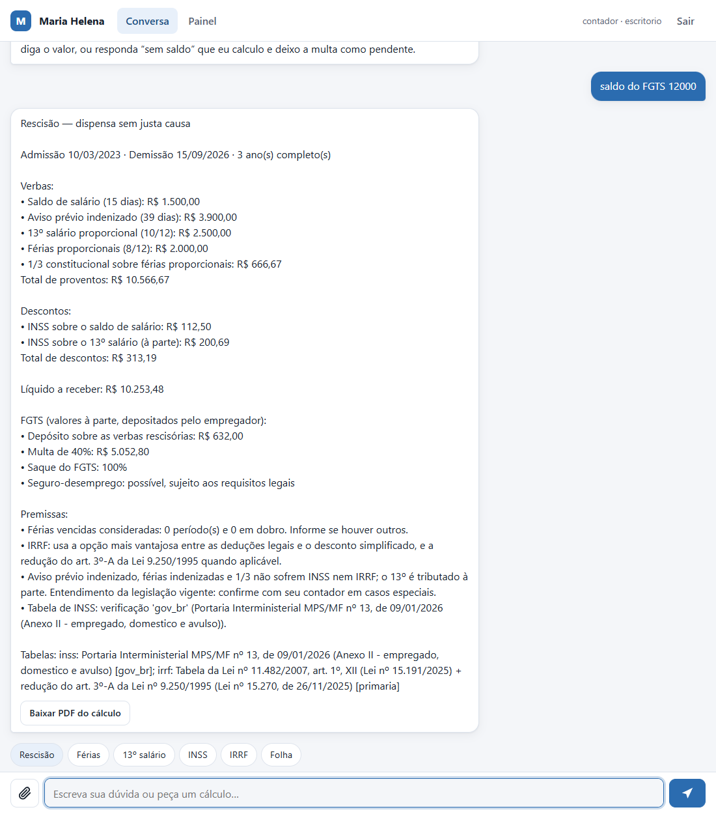
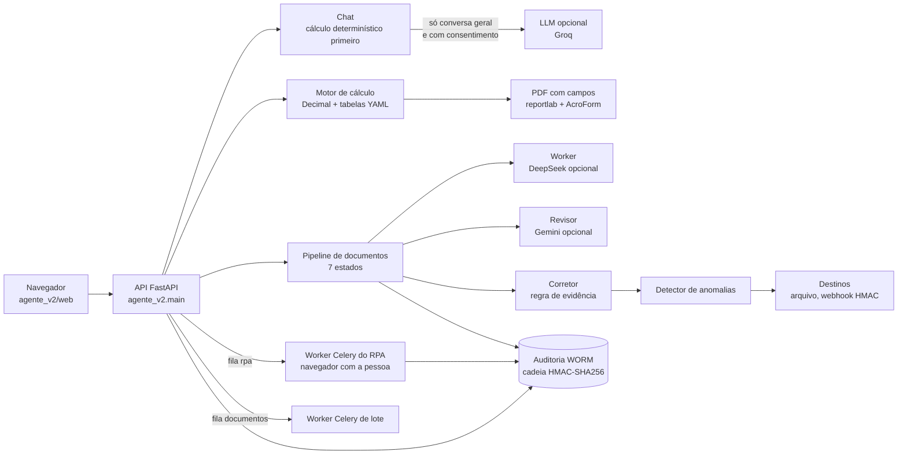

# Sovereign Accounting Agent

[](https://www.python.org/)
[](https://fastapi.tiangolo.com/)
[](LICENSE)
[](https://github.com/matheusStark25/sovereign-accounting-agent/actions/workflows/ci.yml)

Assistente de **Departamento Pessoal e contabilidade** para a legislação brasileira: calcula rescisão, férias,
13º, INSS, IRRF, FGTS e folha com aritmética decimal exata, gera o PDF do cálculo, lê e confere 27 tipos de
documento (holerite, TRCT, guias, SPED, XMLs) e busca o extrato do FGTS com um robô que **pausa para uma
pessoa** resolver login e captcha. Tudo passa por autenticação, isolamento entre empresas e uma trilha de
auditoria à prova de adulteração.

> Os valores calculados vêm do código, nunca de um modelo de linguagem. O LLM só conversa sobre o que não é
> cálculo — e só se a empresa deixar. Se faltar dado ou a tabela de uma competência não existir, o sistema
> **pergunta ou recusa**; ele não estima.



*Captura da interface real, com um cálculo de rescisão (valores de exemplo): cada número vem do motor de cálculo, com as premissas e as tabelas usadas e o botão do PDF.*

---

## Sumário

- [Como funciona](#como-funciona)
- [O que existe de verdade](#o-que-existe-de-verdade)
- [Começando](#começando)
- [API](#api)
- [Documentos](#documentos)
- [RPA: extrato do FGTS e do PGMEI](#rpa-extrato-do-fgts-e-do-pgmei)
- [Segurança e LGPD](#segurança-e-lgpd)
- [Docker, gateway e Vault](#docker-gateway-e-vault)
- [Estrutura do projeto](#estrutura-do-projeto)
- [Testes](#testes)
- [Licença](#licença)

---

## Como funciona



- **Chat:** primeiro o `DialogoCalculo` tenta entender o pedido ("calcular rescisão…") e conduz as perguntas
  que faltam; se tudo estiver completo, calcula pelo motor. Só o que sobra vai ao LLM, com CPF/CNPJ/e-mail
  mascarados e apenas se a empresa registrou o consentimento `envio_a_provedor_de_ia`. Sem chave de LLM o
  sistema continua funcionando para cálculos e regras.
- **Pipeline de documentos:** `RECEIVED → CLASSIFYING → PROCESSING → REVIEWING → CORRECTING → DISPATCHING →
  ARCHIVED`. Worker e Revisor têm modo determinístico (sempre disponível) e usam DeepSeek/Gemini (ou a Groq) quando há
  chave **e** consentimento. O Corretor só aceita um valor sugerido se ele aparecer no texto do documento
  (regra de evidência): o LLM sugere, o documento decide.
- **Auditoria:** cada evento é gravado com PII mascarada numa cadeia HMAC-SHA256 por empresa, com cabeça
  assinada para detectar truncamento. Se a auditoria falhar, a operação falha (a API responde 503).

## O que existe de verdade

| Área | O que está implementado |
|---|---|
| **Cálculo** | Rescisão (sem justa causa, justa causa, pedido de demissão, acordo), férias (com 1/3 e abono pecuniário), 13º, INSS progressivo, IRRF (com a redução da Lei 15.270/2025), FGTS (8%; multa de 40% sem justa causa e 20% em acordo; doméstico 8% + 3,2%), adicionais (horas extras, adicional noturno, insalubridade, periculosidade), folha completa, pró-labore (INSS do sócio, IRRF e custo da empresa), GPS (20%, 11% e 5%), DAS do MEI (INSS + ICMS e/ou ISS) e DARF em atraso (multa e juros da Lei 9.430/1996, com a SELIC acumulada informada, nunca chutada). `Decimal` em tudo; as tabelas ficam em um único arquivo, [`calc/data/tabelas.yaml`](contabil_agente/calc/data/tabelas.yaml). Competência sem tabela → erro explícito. |
| **PDF** | PDF do cálculo com campos AcroForm preenchidos (`/api/v1/calculo/{tipo}/pdf` e no chat). |
| **Documentos** | 27 tipos classificados e extraídos; conferências automáticas em 16 deles (veja [Documentos](#documentos)); detector de anomalias (escore z robusto, duplicidade, competência repetida/futura/antiga); lote assíncrono de até 50 arquivos. |
| **Autenticação** | Login com bcrypt, JWT, bloqueio da conta após 5 senhas erradas (15 min), papéis lidos do banco (cabeçalhos de identidade enviados pelo cliente são ignorados), isolamento por empresa (tenant). |
| **RBAC** | `super_admin`, `tenant_admin`, `accountant`, `auditor`, `viewer`, `guest` com permissões por rota. |
| **LGPD** | Base legal (art. 7) exigida antes de tratar, consentimento por titular e por finalidade, retenção configurável, exclusão de titular respeitando a guarda legal (art. 16), mascaramento de PII em logs e auditoria. |
| **Governança** | Decisões críticas assinadas com ML-DSA-65 (Dilithium); acima do limite do tipo ficam `PENDENTE` até outra pessoa aprovar (regra das duas pessoas); limites em `GOVERNANCA_LIMITES`. |
| **Segredos** | Variáveis de ambiente ou HashiCorp Vault (token ou AppRole). Vault configurado e fora do ar → a API se recusa a subir (sem fallback silencioso). Sem `JWT_SECRET`, `AUDIT_HMAC_KEY` ou `GOVERNANCA_DSA_KEY` ela também não sobe. |
| **Criptografia** | CPF cifrado com ML-KEM-768 + X25519 + AES-GCM (pacote `cryptography`) antes de entrar na fila do Celery; mTLS no gateway (porta 8443) e utilitários mTLS/XML-DSig em `agente_v2/`. |
| **Resiliência** | Circuit breaker, retentativas com backoff exponencial, timeouts, degradação controlada, `/health` e `/ready`. |
| **Agentes** | `TaxAgent` (cálculos), `ValidationAgent` (CPF, CNPJ, PIS, chave de NF-e e documentos), `ReconciliationAgent` (concilia holerites com a guia do FGTS, a GPS e o DARF do IRRF e aponta a diferença em reais), `ComplianceAgent` (regras de conformidade e base legal da LGPD) e `RPAAgent` (extrato do FGTS e do PGMEI), orquestrados pela API em `/api/v1/agentes`: uma ação de um agente ou um plano de até 10 passos, com o resultado de um passo alimentando o seguinte. |
| **Voz** | Microfone no navegador → WebSocket `/ws/voz` (áudio em pedaços) → Whisper (`whisper-large-v3-turbo`, via Groq) → chat → resposta frase por frase, lida em voz alta pela voz do navegador (Web Speech API). Exige o consentimento de IA externa (o áudio vai a um terceiro). O MARCOS adapta o tom (formal, informal ou neutro) ao jeito de quem escreve ou fala; a Maria Helena é a persona técnica de auditoria. |
| **Observabilidade** | Métricas Prometheus em `/metrics`; log com filtro que mascara CPF, CNPJ, e-mail, telefone e nomes rotulados; e, no perfil `observabilidade` do compose, Prometheus, Alertmanager (7 alertas: API fora do ar, erros 5xx, latência, falha na trilha de auditoria, logins recusados, cálculos com erro, voz com falha) e Grafana com o painel "Sovereign Accounting Agent". |
| **Interface web** | Login, conversa com atalhos, envio de documento, microfone e leitura das respostas em voz alta, painel (extrato do FGTS, aprovações pendentes, consentimento de IA, verificação da trilha). Funciona no celular. |
| **CLI** | `python -m agente_v2.cli` cria usuários, gera segredos, chaves do RPA e do ML-DSA, verifica a auditoria, confere de verdade as chaves e modelos de IA (`verificar-ia`), grava a calibragem de portais (`calibrar-fgts`) e baixa extratos do FGTS e do PGMEI com a pessoa resolvendo só o captcha (`baixar-extrato`). |

## Começando

Requisitos: Python 3.12. Redis só é necessário para as filas (lote de documentos e RPA).

```bash
python -m venv .venv
source .venv/bin/activate            # Windows: .venv\Scripts\activate
pip install -r requirements.txt      # versões exatas testadas: requirements.lock
```

Gere os segredos e preencha o `.env` (copie de `.env.example`):

```bash
cp .env.example .env
python -m agente_v2.cli gerar-segredo              # cole em JWT_SECRET
python -m agente_v2.cli gerar-segredo              # cole em AUDIT_HMAC_KEY
python -m agente_v2.cli gerar-segredo              # cole em REDIS_PASSWORD
python -m agente_v2.cli gerar-chave-governanca     # cole a linha GOVERNANCA_DSA_KEY=... inteira
```

Defina `ADMIN_USERNAME` e `ADMIN_PASSWORD` (cria um `super_admin` no primeiro acesso, se ainda não houver
usuários; apague `ADMIN_PASSWORD` depois) e suba a API:

```bash
uvicorn agente_v2.main:app --env-file .env --host 127.0.0.1 --port 8000
```

Abra <http://127.0.0.1:8000> e entre. Para criar outros usuários:

```bash
python -m agente_v2.cli criar-usuario --usuario maria --tenant empresa_a --papeis accountant
```

Para desenvolvimento local use `AGENTE_ENV=dev`: se faltarem, a API cria um `JWT_SECRET` temporário e guarda uma
chave de auditoria e uma chave de governança em `DATA_DIR`, e liga a documentação em `/docs`. Em produção (o
padrão) ela recusa subir sem os segredos obrigatórios. As chaves de IA são opcionais: `GROQ_API_KEY` (conversa),
`DEEPSEEK_API_KEY` (Worker) e `GEMINI_API_KEY` (Revisor); sem as duas últimas, a Groq faz esses papéis. Os provedores
renomeiam e desligam modelos, então `python -m agente_v2.cli verificar-ia --env-file .env` confere chave, modelo e
uma chamada real. Os dados ficam em `DATA_DIR` (padrão `contabil_agente/data`).

## API

A documentação interativa (`/docs`) só fica ligada com `AGENTE_ENV=dev`. Rotas principais, todas com JWT
(`POST /token`) exceto `/health`, `/ready` e `/metrics`:

| Rota | Para quê |
|---|---|
| `POST /token`, `POST /logout`, `GET /users/me`, `POST /users` | Login, logout, usuário atual, criar usuário (admin) |
| `POST /api/chat`, `GET /api/chat/{sessao}`, `GET /api/chat/{sessao}/pdf` | Conversa, histórico e PDF do último cálculo |
| `GET /api/v1/calculo/tipos`, `POST /api/v1/calculo/{tipo}`, `POST /api/v1/calculo/{tipo}/pdf` | Cálculo direto: `rescisao`, `ferias`, `decimo_terceiro`, `inss`, `irrf`, `fgts`, `folha`, `prolabore`, `gps`, `das_mei`, `darf` |
| `GET /api/v1/documentos/tipos`, `POST /api/v1/documentos`, `POST /api/v1/documentos/lote` | Tipos aceitos, processar um arquivo, processar até 50 em segundo plano (202) |
| `POST /api/v1/rpa/fgts`, `POST /api/v1/rpa/pgmei`, `GET /api/v1/rpa/jobs/{id}` | Pedir o extrato do FGTS (CPF) ou do PGMEI (CNPJ) (202) e acompanhar o trabalho |
| `GET /api/v1/agentes`, `POST /api/v1/agentes/{agente}/{acao}`, `POST /api/v1/agentes/orquestrar` | Catálogo dos agentes, uma ação de um agente, ou um plano com vários passos |
| `WS /ws/voz` | Canal de voz: o 1º quadro autentica (`{"tipo": "autenticar", "token": ...}`), depois `inicio`, áudio em pedaços e `fim` (ou `texto`); volta `transcricao`, `fala` frase por frase e `fim_resposta` |
| `POST /api/v1/governanca/decisoes`, `GET …/pendentes`, `GET …/decisoes/{id}`, `POST …/aprovar`, `POST …/rejeitar` | Decisões críticas assinadas e aprovação por limite |
| `GET /api/v1/lgpd/finalidades`, `POST/GET /api/v1/lgpd/consentimentos`, `DELETE /api/v1/lgpd/titular`, `GET /api/v1/lgpd/retencao`, `POST /api/v1/lgpd/retencao/executar` | Consentimento, exclusão de titular e retenção |
| `GET /api/v1/auditoria/verificar` | Confere a cadeia HMAC da sua empresa e devolve a âncora para guardar fora do servidor |
| `GET /health`, `GET /ready`, `GET /metrics` | Saúde, prontidão (espaço em disco e Vault, quando configurado) e métricas Prometheus |

Exemplo (cálculo direto):

```bash
TOKEN=$(curl -s -d "username=maria&password=..." http://127.0.0.1:8000/token | python -c "import sys,json;print(json.load(sys.stdin)['access_token'])")
curl -s -H "Authorization: Bearer $TOKEN" -H "Content-Type: application/json" \
  -d '{"salario":3000,"tipo_rescisao":"sem justa causa","data_admissao":"10/03/2023","data_demissao":"15/09/2026","aviso_previo":"indenizado","saldo_fgts":12000}' \
  http://127.0.0.1:8000/api/v1/calculo/rescisao
```

Nesse cenário a resposta traz `total_proventos` 10566.67, `total_descontos` 313.19, `total_liquido` 10253.48,
multa de FGTS 5052.8 (40% sobre saldo + depósito rescisório) e depósito rescisório 632.0.

## Documentos

Classificação por assinaturas ponderadas (empate entre tipos reduz a confiança; se nenhum tipo atinge a
pontuação mínima o resultado diz que não identificou o tipo, em vez de chutar) e extração por tipo. Aceita PDF,
XML, TXT e CSV de até 25 MB. Os extratores só retêm CPF e CNPJ cujo dígito verificador é válido.

| Categoria | Tipos | O que é conferido além da extração |
|---|---|---|
| Trabalhista | Holerite, TRCT, contrato de trabalho | Holerite: proventos − descontos = líquido e recálculo de INSS, IRRF (sem dependentes) e FGTS pelo motor. TRCT: verbas × total bruto, bruto − descontos = líquido, datas invertidas. Contrato: salário abaixo do mínimo da admissão, jornada acima de 44 h. |
| Trabalhista (só extração) | Recibo de férias, ASO, CAGED, RAIS | — |
| Federal | DARF, DIRF, informe de rendimentos | DARF: principal + multa + juros = total. Informe: IRRF maior que o rendimento, CPF inválido. DIRF: avisa que foi extinta. |
| Federal (só extração) | DAS, DCTF, DCTFWeb, PER/DCOMP | — |
| Previdenciário e FGTS | GPS, GRRF, guia do FGTS Digital, extrato do FGTS | GPS: soma dos componentes. GRRF/guia: 8% da base × valor da guia. Extrato: dígito verificador do PIS. |
| Previdenciário (só extração) | GFIP/SEFIP | — |
| SPED | ECD, ECF, EFD ICMS/IPI, EFD Contribuições | Estrutura dos registros, CNPJ do 0000, período invertido. |
| XML | NF-e, eventos do eSocial | NF-e: dígito da chave de acesso, CNPJ e número dentro da chave, vNF = soma dos totais. eSocial: evento reconhecido, CPF e CNPJ válidos. |
| XML / municipal (só extração) | EFD-Reinf, NFS-e | — |

O detector de anomalias (histórico em SQLite, separado por empresa) marca: arquivo já processado, competência
repetida, competência no futuro ou com mais de 5 anos, valor zerado, valor atípico (só com 5+ observações
anteriores), INSS acima de 14% e IRRF acima de 27,5% dos proventos. Isso vira alerta no resultado e na
auditoria; alerta de erro, arquivo duplicado ou valor atípico marcam `requer_revisao`.

**Destinos do resultado:** o arquivo (documento original + JSON em
`DATA_DIR/arquivo/<empresa>/<tipo>/<sha256>`, permissão `0600`) está sempre ligado. Defina
`DOCUMENTOS_WEBHOOK_URL` e `DOCUMENTOS_WEBHOOK_SECRET` para também enviar cada resultado por POST assinado
(`X-Signature: sha256=<HMAC-SHA256 do corpo>`, HTTPS obrigatório, com retentativas e disjuntor); ele recebe o
resultado de **todas** as empresas da instalação, então aponte só para um serviço seu. Uma falha do webhook
vira alerta e não impede o arquivamento. Também existe `CallbackDestino` (uma função Python), disponível só
pela API Python ao montar o `DocumentDispatcher`.

## RPA: extrato do FGTS e do PGMEI

Dois robôs (Playwright) com o mesmo princípio: **a pessoa só resolve o captcha (ou o login); o resto é do robô**, e o
robô não trava por bobeira.

- **FGTS** (extrato por CPF) e **PGMEI** (extrato/DAS do MEI por CNPJ, portal público da Receita). O PDF baixado
  entra no pipeline de documentos.
- Só baixa PDF de verdade (confere a assinatura e o tamanho), calcula o SHA-256 e guarda `0600`.
- Só navega nos hosts permitidos, conferidos de novo depois de cada redirecionamento.
- O CPF/CNPJ nunca vai em claro para o broker (cifrado com ML-KEM + X25519 + AES-GCM) e na auditoria só entra o hash.
- Sem captcha solver e sem flags para esconder a automação (um teste confere que não existem no código).

**Quando o site muda ou demora** (para não travar por bobeira):

1. **Espera** o elemento aparecer (`espera_elemento_s`, 15 s): páginas lentas ou que montam a tela por JavaScript.
2. Procura em **todos os quadros** da página, inclusive `iframe`.
3. Se o seletor configurado não acha nada, acha **pelo que o elemento é**: rótulo, placeholder, nome/id, texto do
   botão ou do link (`rotulo_campo`, `rotulo_envio`, `rotulo_download`). Anota na trilha o passo `seletor_alternativo`
   com o seletor que você deve pôr na configuração.
4. Se ainda assim não achar, **pede ajuda na própria janela** em vez de abortar: aparece um aviso amarelo com o botão
   "Terminei esta etapa". A pessoa faz o passo (ou clica no link do PDF, que o robô pega) e o robô continua dali
   (`ajuda_humana`, ligado por padrão). Em todos os casos ele salva um `diagnostico_<etapa>_<hora>.json` com a
   estrutura da página (botões, campos, links; números e e-mails mascarados), sem nada digitado.
5. Se o portal **reprova o navegador automatizado** (ex.: "Comportamento de Robô"), ele falha na hora, com
   mensagem clara e **sem nova tentativa** (insistir só piora): baixe o PDF no seu navegador normal e envie por
   `POST /api/v1/documentos`.

Como rodar, direto da linha de comando (abre a janela; você resolve o captcha e só):

```bash
python -m agente_v2.cli baixar-extrato --portal pgmei --documento 11.222.333/0001-81 --ano 2026 --canal msedge
python -m agente_v2.cli baixar-extrato --portal fgts  --documento 529.982.247-25 --canal msedge
```

Ou pela API (fila `rpa`, com a pessoa na máquina do worker):

```bash
python -m agente_v2.cli gerar-chaves-rpa --saida ./chaves   # coloque RPA_PQC_PUBLIC_KEY na API e RPA_PQC_PRIVATE_KEY no worker
playwright install chromium                                  # ou use FGTS_BROWSER_CHANNEL=msedge|chrome
celery -A contabil_agente.tarefas worker -Q rpa --pool=solo --loglevel=info
```

O worker `rpa` precisa rodar **em uma máquina com tela** (a pessoa resolve o captcha na janela) e enxergar o
mesmo `DATA_DIR` e os mesmos segredos da API (status das tarefas, auditoria e LGPD ficam em arquivos ali). O
caminho mais simples é rodar API e worker no mesmo computador. Ele **não** está no `docker-compose.yml`, de
propósito. Configuração: `FGTS_CAIXA_URL`, `FGTS_PORTAL_CONFIG`, `FGTS_BROWSER_CHANNEL`, `FGTS_BROWSER_USER_DATA_DIR`
(e `PGMEI_PORTAL_CONFIG`, `PGMEI_BROWSER_CHANNEL`, `PGMEI_BROWSER_USER_DATA_DIR`); o YAML aceita seletores,
rótulos, tempos, `ajuda_humana` e `capturar_tela_na_falha` (a captura de tela pode mostrar dados pessoais, por
isso vem desligada).

**Nos portais reais (testado em 2026-10-17):** o PGMEI e a Caixa recusam navegador controlado por automação (o PGMEI
responde "13896 - Impedido por proteção Captcha. Comportamento de Robô"). Nesse caso o robô avisa, e você baixa o PDF no
navegador normal e envia por `POST /api/v1/documentos`, que classifica, extrai, confere e arquiva. Os robôs foram
testados de ponta a ponta contra portais falsos que reproduzem mudança de layout, demora, `iframe` e bloqueio.

## Segurança e LGPD

- **Tenant isolado:** cada consulta carrega o `tenant_id` do token; acessar dado de outra empresa dá 404/403
  (testado contra IDOR).
- **Sem segredo no código:** um teste varre os arquivos versionados atrás de chaves e dados de execução.
- **Cabeçalhos:** CSP restritiva, `X-Content-Type-Options`, `Referrer-Policy`, CORS por lista (`ALLOWED_ORIGINS`),
  HSTS com `HTTPS_ONLY=1`, limite de tamanho do corpo JSON.
- **Gateway:** nginx com TLS (443) e mTLS obrigatório na 8443 (`ssl_verify_client on`); identidade enviada pelo
  cliente nunca é repassada; `/metrics` não é exposto na porta pública.
- **Auditoria verificável:** `python -m agente_v2.cli verificar-auditoria` ou `GET /api/v1/auditoria/verificar`.
  Guarde a âncora devolvida fora do servidor para detectar quem apague o fim da cadeia.
- **LGPD:** finalidades e bases legais em `contabil_agente/lgpd/`; retenção em `RETENCAO_CONFIG`; exclusão de
  titular preserva o que a lei manda guardar.

## Docker, gateway e Vault

```bash
cp .env.example .env                                  # preencha os segredos: o compose se recusa a subir sem eles
docker compose up --build                             # API (8000), worker de documentos e Redis com senha
docker compose --profile gateway up --build           # + nginx: https://localhost e mTLS em :8443 (certificados em ./certs)
docker compose --profile dev up --build               # + Vault em modo dev (nunca em produção)
docker compose --profile observabilidade up -d        # + Prometheus (9090), Alertmanager (9093) e Grafana (3000), só em 127.0.0.1
```

Para o perfil `observabilidade`, defina `GRAFANA_ADMIN_PASSWORD` no `.env` (o Grafana se recusa a subir sem ela) e, se quiser receber os alertas fora da tela do Alertmanager, `ALERTA_WEBHOOK_URL` (só HTTPS).

Para gerar certificados de desenvolvimento (CA própria, servidor e cliente, válidos por 7 dias):
`python -c "from agente_v2.mtls import emitir_certificados_dev as e; e('certs')"`. Em produção use certificados
da sua autoridade. Há também uma unidade systemd
de exemplo em `deploy/maria-helena.service`.

## Estrutura do projeto

```
agente_v2/                  API e infraestrutura de execução
├── main.py                 aplicação FastAPI (create_app) e rotas
├── auth.py, config.py      autenticação (reexport) e configuração por ambiente
├── vault_client.py         Vault (token/AppRole) e carga de segredos
├── mtls.py, signing.py     certificados mTLS e assinatura XML-DSig
├── rotas_agentes.py        API dos agentes e do orquestrador
├── rotas_voz.py            canal de voz (WebSocket)
├── cli.py, logging_setup.py
├── web/                    interface (index.html, app.css, app.js)
└── tests/                  API, Vault, mTLS, assinatura e front-end (navegador real)

contabil_agente/            domínio e serviços
├── calc/                   motor de cálculo (Decimal) e tabelas YAML
├── chat/                   motor da conversa, LLM, armazenamento
├── intelligence/           diálogo de cálculo, extração, auditoria forense, FSM
├── documentos/             leitura, 27 tipos, validadores, PDF
├── pipeline/               dispatcher, agentes, anomalias, evidência, destinos
├── agentes/                TaxAgent, ValidationAgent, ReconciliationAgent, ComplianceAgent, RPAAgent e o orquestrador
├── voz/                    Whisper (fala para texto)
├── rpa/                    robôs do FGTS e do PGMEI, pausa humana, calibragem, estado das tarefas
├── tarefas/                Celery (filas documentos e rpa)
├── security/               auth, RBAC, auditoria WORM, PQC, Vault, criptografia
├── lgpd/                   base legal, consentimento, retenção, anonimização
├── middleware/             autenticação, cabeçalhos, limite de uso, métricas
├── resilience/             circuit breaker, retry, timeouts, readiness
├── governance/ governance_manager.py   decisões assinadas e aprovação
├── core/, config/, tools/, models/, utils/, orchestrator/
└── tests/                  testes de cálculo, pipeline, RPA, LGPD, infraestrutura…

rules/compliance_rules.yaml regras de conformidade
observabilidade/           Prometheus, alertas, Alertmanager e painel do Grafana
Dockerfile, docker-compose.yml, nginx/, deploy/, .github/workflows/ci.yml
```

## Testes

```bash
pip install -r requirements-dev.txt
playwright install chromium            # os testes do RPA e do front-end usam um navegador de verdade
pytest
flake8 agente_v2 contabil_agente --select=E9,F63,F7,F82,F401,F811,F841,F541
```

A suíte cobre o motor de cálculo (inclusive cenários conferidos à mão), a API e o isolamento entre empresas, o
robô contra um portal falso local, o front-end em navegador real, a cadeia de auditoria (adulteração e
truncamento), LGPD, governança, criptografia e a consistência da infraestrutura. A criptografia pós-quântica
(ML-KEM-768 e ML-DSA-65, do pacote `cryptography`) é conferida a cada execução contra duas implementações
independentes (`kyber-py` e `dilithium-py`, só nos testes). Os testes de IA ao vivo
(`contabil_agente/tests/test_ia_ao_vivo.py`) rodam quando há chave em `.env.teste` (verificados com a Groq). O CI (`.github/workflows/ci.yml`) roda lint, testes,
`pip-audit`, a construção da imagem e a **pilha completa** do `docker-compose.yml` (API, worker, Redis com senha
e nginx): confere o `/health` pelo TLS, o `/metrics` fechado na porta pública, a porta 8443 recusando quem não
tem certificado de cliente (mTLS), o login com uma rota protegida e o worker falando com o Redis. Outro job sobe a observabilidade: o Prometheus enxerga a API e carrega as 7 regras sem erro, uma métrica real aparece depois de usar a API, o Grafana abre com o painel e a fonte de dados (e exige login), e um alerta de verdade (derrubar a API) chega ao Alertmanager.

## Licença

[MIT](LICENSE)
